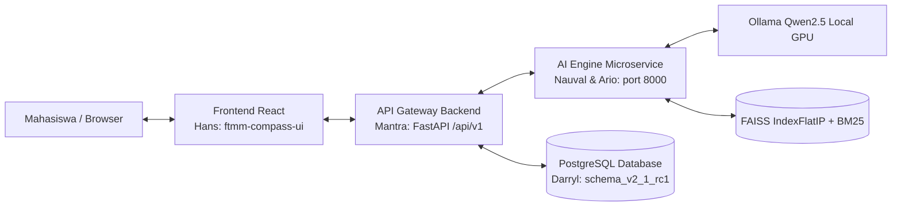
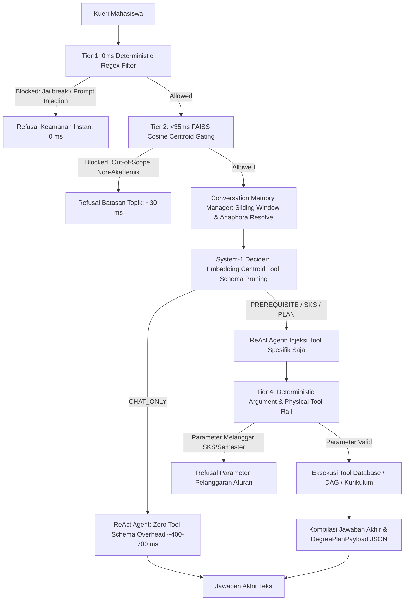
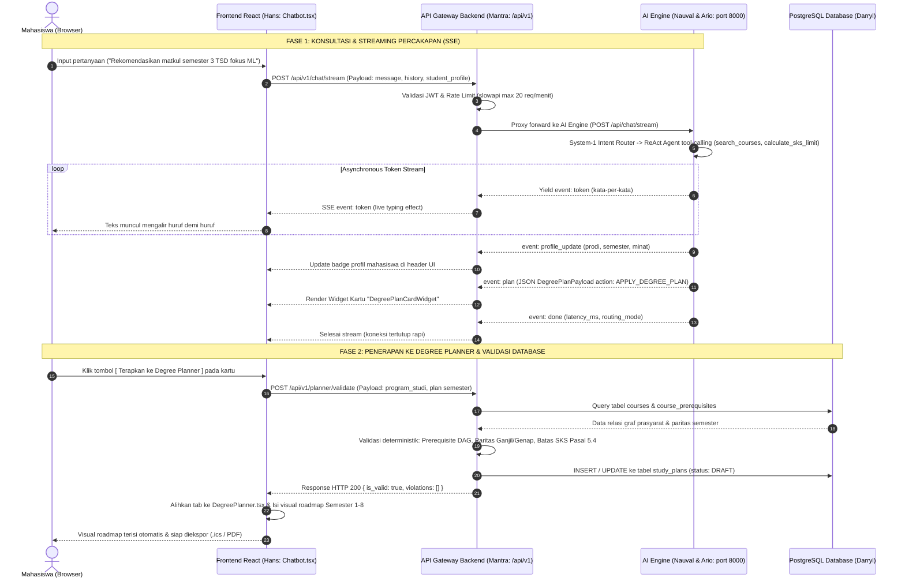

# FTMM COMPASS — Arsitektur & Alur Integrasi End-to-End

> **Klasifikasi:** Dokumen Arsitektur Sistem & Spesifikasi Antarmuka (Tracked in Git).  
> **Aset Visual draw.io:** `docs/architecture/ftmm_compass_integration_flow.drawio.xml` (Bisa dibuka & diedit di [app.diagrams.net](https://app.diagrams.net/) atau VS Code Draw.io extension).  
> **Kartu Trello:** Kolom `📌 Project Hub & Quick Links` ➔ `📐 Arsitektur & Alur Integrasi End-to-End (draw.io)`.

---

## 1. Ringkasan Arsitektur Sistem Multi-Tier

Sistem **FTMM COMPASS** dirancang dengan pemisahan tanggung jawab yang tegas antar 4 layer (Tier):



| Layer | Komponen & Repository | Penanggung Jawab | Peran Utama |
|---|---|---|---|
| **Tier 1: Client / UI** | `ftmm-compass-ui/src/pages/Chatbot.tsx`<br>`DegreePlanner.tsx` | Hans (Frontend) | Antarmuka obrolan responsif, konsumsi SSE live typing, visualisasi roadmap semester 1–8. |
| **Tier 2: API Gateway** | `ftmm-compass-ui/backend` / FastAPI Core | Mantra (Backend) | Routing reverse proxy, validasi JWT Auth, rate limiting `slowapi`, SSE streaming relay, dan logging sesi. |
| **Tier 3: AI Microservice** | `ftmm-compass-chatbot/src/` | Nauval & Ario (AI/NLP) | System-1 intent routing, Hybrid RAG-CAG, ReAct agent dengan 4 deterministic tools, dan compile `DegreePlanPayload`. |
| **Tier 4: Relational DB** | PostgreSQL 16 (`schema_v2_1_rc1.sql`) | Darryl (Database) | Relasi prasyarat matkul (`course_prerequisites` DAG), paritas ganjil/genap, dan persistensi rencana studi. |


### 1.1 Pipeline Internal AI Engine Microservice (Hasil Riset Exp-008 s.d. Exp-011)

AI Engine mengimplementasikan arsitektur *Cascaded Defense-in-Depth* dan *System-1 Decider*:



| Komponen Pipeline | Modul Sumber | Mekanisme & Target Latensi | Status Validasi |
|---|---|---|---|
| **Tier 1 Security Filter** | `src/guardrails/tier1_filter.py` | Regex blocklist instan (0.0 ms) untuk cegah prompt injection & DAN jailbreak. | Tuntas (Exp-008, 0% ASR) |
| **Tier 2 Semantic Gating** | `src/guardrails/tier2_semantic_gate.py` | FAISS Centroid Cosine Distance (<35 ms) mendeteksi kueri OOD tanpa beban LLM. | Tuntas (Exp-008, 100% OOD-R) |
| **Memory Manager** | `src/engine/memory.py` | Sliding window 6 turn + persistensi profil mahasiswa & resolusi anafora (*itu, tersebut*). | Tuntas (Exp-009, 94.3% Success) |
| **System-1 Decider** | `src/engine/decider.py` | BLAS Dot-product (34 ms) memangkas ~675 token skema JSON sebelum menyentuh LLM. | Tuntas (Exp-011, 96.7% Acc) |
| **ReAct Agent Engine** | `src/engine/react_agent.py` | Qwen2.5-3B VRAM Pinned (`OLLAMA_MAX_LOADED_MODELS=2`) + DeepSeek-style prefix cache. | Tuntas (Exp-010, P50 1.39s) |
| **Tier 4 Argument Rail** | `src/guardrails/tier4_tool_rail.py` | Validasi batas legal semester (1–8) dan SKS (0–24) sebelum pemanggilan tool. | Tuntas (Exp-008) |
---

## 2. Sequence Diagram Alur Integrasi End-to-End



---

## 3. Spesifikasi Kontrak Data Antar-Layer

### A. Kontrak Dialog Streaming (Tier 2 ➔ Tier 3 & Tier 1)
- **Path:** `POST /api/v1/chat/stream`
- **Request Body:**
  ```json
  {
    "message": "Buatkan rencana studi semester 3 prodi TSD peminatan Machine Learning",
    "history": [
      { "role": "user", "content": "Halo" },
      { "role": "assistant", "content": "Halo! Ada yang bisa saya bantu?" }
    ],
    "student_profile": {
      "program_studi": "Teknologi Sains Data",
      "semester_saat_ini": 2,
      "riwayat_matkul_lulus": ["Dasar Pemrograman", "Matematika I"],
      "minat_fokus": ["Machine Learning"],
      "target_kelulusan_semester": 8,
      "maks_sks_per_semester": 24,
      "is_confirmed_by_user": true
    }
  }
  ```

- **Format Server-Sent Events (SSE):**
  ```
  event: token
  data: {"token": "Tentu"}

  event: token
  data: {"token": ", berikut"}

  event: profile_update
  data: {"program_studi": "Teknologi Sains Data", "semester": 3, "minat_fokus": ["Machine Learning"]}

  event: plan
  data: {
    "action": "APPLY_DEGREE_PLAN",
    "summary": {
      "program_studi": "Teknologi Sains Data",
      "current_semester": 3,
      "target_semester": 8,
      "total_credits": 20,
      "focus_tracks": ["Machine Learning"]
    },
    "plan": {
      "3": [
        { "code": "SID201", "name": "Algoritma dan Struktur Data", "credits": 3 },
        { "code": "SID203", "name": "Statistika Matematika", "credits": 3 }
      ]
    }
  }

  event: done
  data: {"routing_mode": "HYBRID", "latency_ms": 1824.5}
  ```

### B. Kontrak Validasi Database Degree Planner (Tier 1 ➔ Tier 2 ➔ Tier 4)
- **Path:** `POST /api/v1/planner/validate`
- **Request Body:** Sesuai field `plan` dari `DegreePlanPayload`.
- **Response Body:**
  ```json
  {
    "is_valid": true,
    "violations": [],
    "total_sks": 144,
    "semester_sks": {
      "3": 20,
      "4": 20
    }
  }
  ```

---

## 4. Cara Membuka & Mengedit File Diagram draw.io

File diagram asli berada di `docs/architecture/ftmm_compass_integration_flow.drawio.xml`.
1. **Melalui Browser:**
   - Kunjungi [https://app.diagrams.net/](https://app.diagrams.net/).
   - Pilih *Open Existing Diagram* dan pilih file `docs/architecture/ftmm_compass_integration_flow.drawio.xml`.
2. **Melalui VS Code:**
   - Pasang ekstensi `Hediet.vscode-drawio`.
   - Buka file `docs/architecture/ftmm_compass_integration_flow.drawio.xml`, diagram akan langsung terbuka secara visual di editor.
